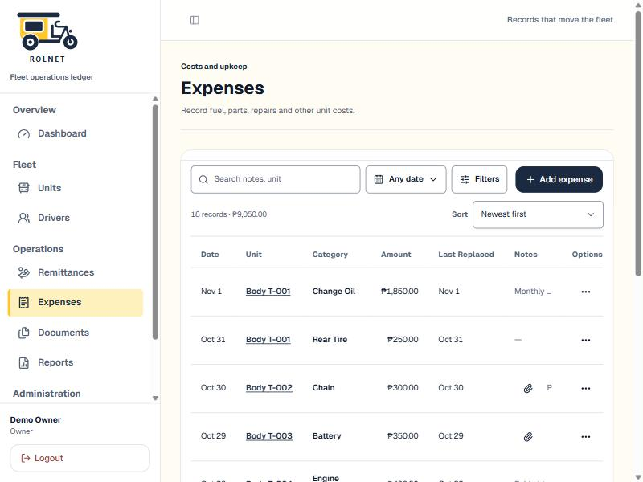

# Validation: Merged Expenses Page

**Date**: 2026-11-02 | **Branch**: `011-merged-expenses-page`

## Automated checks

| Check | Result |
|-------|--------|
| `corepack pnpm lint` | Pass: 0 errors (4 existing warnings in `app/actions/auth.ts`, `demo-login-form.tsx`) |
| `corepack pnpm typecheck` | Pass, after clearing stale `.next/types` left by an earlier build |
| `corepack pnpm test` (Vitest) | Pass: 43 files, 305 tests |
| pgTAP, full suite on rolnet-dev (rollback wrapper) | Pass: 49/49 files (after fixing the plan count in `rls/120`) |
| `corepack pnpm check` (vinext) | 95% compatible, 0 issues |
| `corepack pnpm build:vinext` | Build complete |
| Playwright on the demo build (:3100, 360 px) | `expenses-merged` 10/10, `list-sort-filter`, `dashboard-refresh`, `unit-archive`, `units-daily-assignment`, `paged-lists`, `soft-delete-audit` pass |

**Known failures, not caused by 011**: `app-navigation` (4 tests time out filling the sign-in form),
`ui-system-refresh` "public workspace…" and `accessibility-mobile` (no "Sign in" link at `/`). All
three need live sign-in, which the demo build doesn't have. The navigation counts in
`app-navigation` were still updated for the nine destinations.

## Database (rolnet-dev)

- Backup taken before migration 2: JSON of `expenses` (104), `part_replacements` (74),
  `tire_installations` (61), and `expense_categories` (4), saved to the session scratchpad.
- Dry run inside a rolled-back transaction: 236 expenses after the move, 132 moved, the per-unit
  check passed, and the `category` column was absent afterwards (rolled back).
- Push applied `20261101000500`, `20261101000600`, and `20261101000700`.

## Design

No new design pattern. The "Others" tag reuses `.status-badge`, and "Needs review" reuses
`StatusBadge` (warning). `DESIGN.md` is unchanged.

## Still open

- **T061**: the quickstart §5 manual walkthrough on the :3000 live dev server against rolnet-dev,
  including the plain-language check (constitution IV) and the SC-001 timing. It needs the owner to
  sign in.
